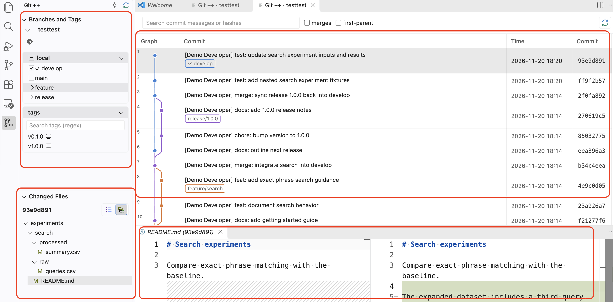

# Git ++

Browse branches, tags, and commit history in VS Code. Open a Git repository and select **Git ++** in the Activity Bar.

- **Branches and tags** — Use branch checkboxes to choose which histories appear in the graph. Click a selected branch or tag to jump to its commit. Filter tags by regular expression, such as `^release/v2\.`.
- **Commit graph** — Search commit messages or hashes. Press **Enter** for the next match. Use **--first-parent** or **--merges** to narrow the history.
- **Changed files** — Click a **Graph** cell to see its changes. Hold **Command** and click a second cell to compare two commits. Select a file to open it in VS Code's Diff Editor, or click **↗** to open its working tree copy in an editor tab.
- **Remotes** — Select **Fetch** to run `git fetch --all --tags`. Right-click a branch to pull or push.
